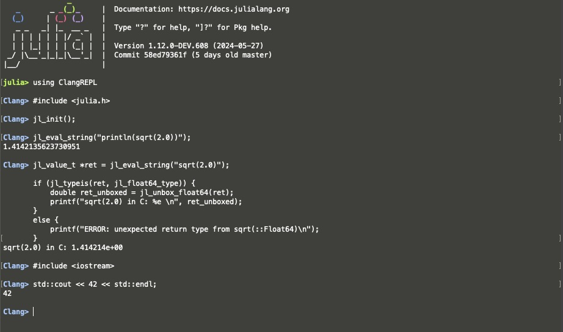

# ClangREPL

[](https://github.com/Gnimuc/ClangREPL.jl/actions/workflows/CI.yml?query=branch%3Amain)

This package provides a REPL mode to evaluate C/C++ code in the Julia REPL, driven by [ClangCompiler.jl](https://github.com/Gnimuc/ClangCompiler.jl)'s incremental interpreter. Expression increments print a C++ type and payload; failed increments show clang diagnostics. Tab completes C++ names, Enter waits on unmatched braces, and `%` starts a metacommand (`%help`, `%undo`, `%lib`, `%include`, `%decl`, `%ir`, `%ast`).

This is a tool for playing with pure C/C++ stuff and does not provide any interoperability between Julia and C/C++.

## Installation

```julia-repl
pkg> dev https://github.com/Gnimuc/ClangREPL.jl.git
```

Press <kbd>,</kbd> to ...



```
julia> using ClangREPL

Clang> #include <julia.h>

Clang> jl_value_t *ret = jl_eval_string("sqrt(4.0)");

Clang> JL_GC_PUSH1(&ret);

Clang> ret

julia> x = ans
Ptr{Nothing}(0x0000000109c15410)

julia> ccall(:jl_unbox_float64, Float64, (Ptr{Cvoid},), x)
2.0
```

## Credits

Inspiration drawn from [Pkg.jl](https://github.com/JuliaLang/Pkg.jl) and [LispREPL.jl](https://github.com/swadey/LispREPL.jl).
